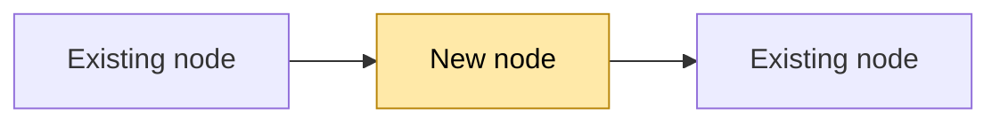

# Diagrams in codesign documents

Read this before writing the questions file or the implementation plan, and whenever a doc the plan produces needs a diagram.
Mermaid is the format because the user's viewers render it from a fenced block (GitHub, VS Code markdown preview, the repo's own docs), so the diagram lives in the markdown and diffs like text.

## When a diagram earns its place

Draw one when the mechanism is spatial or temporal and prose would make the reader rebuild the picture in their head:

- Components and the data that flows between them.
- The order of interactions across processes, services, or a device link.
- A lifecycle with states and the events that move between them.
- A contract or data model with relations.

Do not draw one for a list, a table of options, or a single call.
Every diagram is preceded by one sentence saying what it shows, and followed by the facts it rests on (paths and symbols) when it describes existing code.

## Which type

| What is being shown | Mermaid type | Notes |
|---|---|---|
| Components and data flow | `flowchart LR` or `flowchart TB` | Use `subgraph` for process or machine boundaries (device, host, app, cloud). |
| Interaction order across processes | `sequenceDiagram` | One participant per process or service; `Note over` for a step that needs explaining. |
| Lifecycle | `stateDiagram-v2` | Name the event on each transition. |
| Contracts and data models | `classDiagram` | Fields and relations only; no methods unless they are the contract. |
| Tables and keys | `erDiagram` | For storage schemas. |

Stay with these five types.
Newer mermaid syntaxes (`architecture-beta`, `block-beta`, C4) render in fewer viewers and are not worth the risk in a hand-off document.

## Showing a change

The reader's question is always "what is different", so make the difference visible:

- Highlight changed or new nodes with a class, and say so in a one-line legend under the diagram:

- For a sequence, wrap the new or changed steps in a `rect` block, or put a `Note over` on them.
- For a lifecycle, suffix new states with `(new)` and name removed transitions in the legend.
- When the before and after differ in shape, draw both, side by side under "Before" and "After" headings, rather than one diagram carrying both.

## Keeping it readable

- At most about 25 nodes per diagram; split by concern before it gets bigger.
- One diagram per concern, question, or phase, not one diagram for the whole system.
- Short node ids, human labels: `sup[Supervisor process]`, not `supervisor_process_that_launches_the_child`.
- Quote labels that contain parentheses, colons, or pipes: `A["probe_board() result"]`.
- Avoid `end` as a bare node id in flowcharts; it is a keyword.
- Edge labels name the data or the event, not the verb: `-- SampleChunk -->`, `-- ble_retarget -->`.

## Checking it renders

If `mmdc` (mermaid-cli) is available, render the file to catch syntax errors before handing it over; otherwise ask the user to open the preview once and say whether every diagram drew.
A diagram that does not render is worse than none, because the reader sees a code block and assumes the agent did not check.
