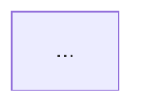

# Questions file template

Read this when opening discovery.
The questions file replaces a wall of questions in chat: it gives the user the current state as the agent understands it, with diagrams, then the questions, then sketches of where the design could go, so each question can be answered against a picture.
The user answers inline under each question or in chat; the agent reads the file back at the start of the next turn.

Name it `<descriptive_name>_questions.md`, put it beside the implementation plan (the repository root unless the repo's plans live elsewhere), and make sure the repo's ignore rules cover it (add `*_questions.md` beside the `*implementation_plan.md` rule if they do not).
Keep one sentence per line, use regular dashes, and read [diagrams.md](diagrams.md) before drawing.

Contents of the skeleton:

- What I read
- Working hypothesis
- Current state as I understand it, one diagram per concern
- Questions, grouped by theme, each with a guess and an answer line
- Candidate directions, two or three sketches with change diagrams
- Out of scope, as I understand it
- Anything important I haven't asked about?

---

# <Title>: codesign questions

Written <YYYY-MM-DD>, before any recommendation.
Answer under each question, or in chat; this file is gitignored and is read back by the agent.

## What I read

- <rules files, ADRs by id, existing plans, docs, memory files, and the source paths that shaped the picture below>

## Working hypothesis

<One paragraph: what the agent currently believes the right shape is, and a confidence level (low, medium, high) with the one or two unknowns that would move it.>
<Stated first so the user can correct the lean before answering the questions it produced.>

## Current state as I understand it

<Two to five short sections, one per concern that the request touches.>
<Each section: one sentence on what the diagram shows, the diagram, then the facts it rests on with paths and symbols.>
<Say plainly where the picture is inferred rather than read, so the user can correct it.>

### <Concern 1>

<One sentence.>

Facts: <path, symbol>; <path, symbol>.

### <Concern 2>

…

## Questions

<6 to 12 questions in the first batch, grouped by theme, numbered continuously so answers can refer to them.>
<Each question carries one line on why it matters, the agent's guess, and, when it helps, the options the agent sees; a guess the user can correct in one word is faster than an open question.>
<Stop adding questions when the next three answers are predictable; a question whose answer the repo gives is removed.>

### <Theme>

1. **<Question>**
   Why it matters: <one line>.
   My guess: <the answer the agent expects, and why>.
   Options I see: <a>, <b>, <c>.
   Answer:

2. **<Question>**
   Why it matters: <one line>.
   My guess: <…>.
   Answer:

### <Theme>

3. …

## Candidate directions (sketches, not recommendations)

<Two or three directions that make the questions concrete.>
<Each: a diagram of the change with changed nodes highlighted, what it optimises for, what it costs, and which questions above it hinges on.>
<These are hypotheses that discovery will confirm or kill; the proposal comes after the playback, not here.>

### Direction A: <name>

<One sentence.>

Optimises for: <…>.
Costs: <…>.
Hinges on: questions <n>, <m>.

### Direction B: <name>

…

## Out of scope, as I understand it

- <what this work will not do, listed so the user can object; silent disagreement about non-goals is half of all misalignment>

## Anything important I haven't asked about?

Answer:

<A question left unanswered is open, not agreed; the playback lists it under Still open.>
