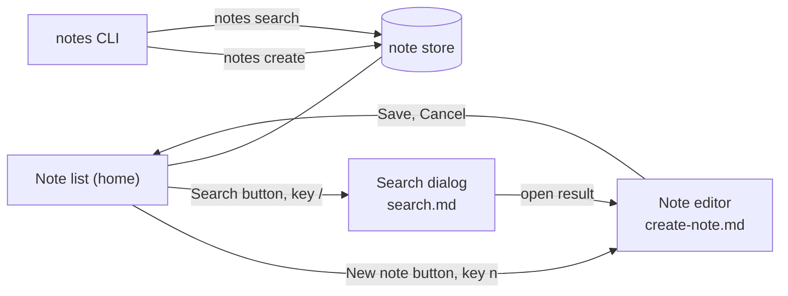

# Notes verification map

This directory is the maintained source for verifying the user-facing behaviour of Notes, a fictional Flutter desktop app with a `notes` CLI over the same store.
Read this index before driving the app, then use the matching feature file as the recipe.
The app is invented; copy the shape of this map, not its content.

## Baseline preconditions

- Launch Notes with `just notes-app --driver`, the debug-only entry point that enables the driver extension, with `NOTES_DATA_DIR` set to a disposable directory under `notes_verification/<date>/data/` so runs do not share state.
- The VM service URI is printed on stdout; connect the Dart MCP server to it before the first drive.
- Seed notes titled `Quarterly plan` (body `Draft budget`) and `Grocery list` with `just notes -- seed --dir <data dir>`.
- Run `just notes-doctor` and require the expected data directory and the build id, the git sha shown under Settings > About and by `notes --version`.
- Never drive an instance this run did not start; Notes allows one instance per data directory.

## Driving conventions

- Start every recipe from the baseline state unless its preconditions say otherwise.
- UI actions go through the Dart MCP server's `flutter_driver_command`.
  In recipes, `tap key:<k>` means command `tap` with finder `ByValueKey('<k>')`, `tap text:"<t>"` means `tap` with `ByText('<t>')`, `type key:<k> "<text>"` means `tap` on that key followed by `enter_text`, `wait text:"<t>"` means `waitFor` with `ByText('<t>')`, `read key:<k>` means `get_text`, and `screenshot <path>` means the driver `screenshot` command saved to that path.
- Terminal actions go through `just notes -- <command>`; the recipe keeps the venv and the data directory flag.
- Prefer widget keys and visible text over positions; keys are listed in each feature file and declared in `lib/keys.dart`.
- Treat every command as literal; keep quoted names and flags unchanged.
- Restore seeded data after a mutation; do not remove proof artifacts during cleanup.

## Proof and skip reporting

- Capture the user action and the resulting state, not only the final screen.
- UI proof is a driver screenshot to `notes_verification/<date>/<feature-id>/<nn>_<what>.png`, taken after the `wait` that proves the state, with the `read` text saved beside it as `<nn>_<what>.txt`.
- CLI proof includes the command, stdout, stderr, and the exit code.
- Mutation proof includes a second, read-only view of the stored value: reopen from the list, or `notes show`.
- Record the feature id, the entry point used, and the build id with every artifact in that feature's `walkthrough.md`.
- Report an unreachable path with the attempted command and the unmet precondition.
- Do not report a skipped entry point as verified through a different path.

## Feature entry contract

Each feature file starts with an H1 title, a `Status:` line (`drafted from source, not yet driven`, or `driven on <date>`), and one paragraph describing the user-visible behaviour.
It then uses exactly four H2 sections in this order.

1. `Sub-features` lists short ids with one line for each behaviour.
2. `How to get to it (user POV)` lists every user entry point.
3. `Driving it with <harness>` starts with `Preconditions:` and uses labelled bullets that pair each user action with an exact command and an observable result, ending with a `Proof` bullet.
4. `Gotchas` lists traps that can waste or invalidate a verification run.

Keep implementation details out of the map; name only user paths, stable handles, required state, commands, and observable proof.

## Navigation

## Features

- [Create a note](./create-note.md) covers editor and CLI creation, cancellation, persistence, and cleanup.
- [Search notes](./search.md) covers toolbar, keyboard, and CLI search with matching, empty, and clear states.
